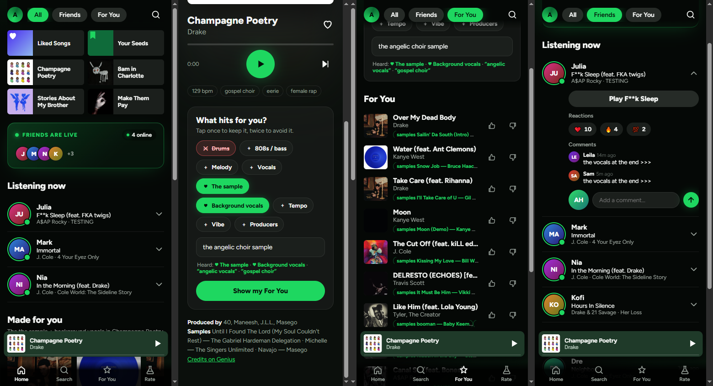

# Facets: recommend by the part you love

**Live demo:** https://ahmadsmadi44.github.io/facets/

Most recommenders hand you "songs like this song". Facets lets you say *which part* of each song
you love while it plays: the drums, the sample, the vocals, the 808s, the background vocals, the
producers, or plain words like "the angelic choir sample". Do that for a few songs and it builds
your taste from those parts, then recommends songs that really sound like them. The look is
Spotify-style, after the "Spotify 2.0" concept reel by @xzecreative.



> Concept project. Not affiliated with Spotify. Audio is 30-second previews streamed from Apple
> (one track from Deezer).

## Using it

1. Play a song and open the player. Under **What hits for you in this song?** tap a part once if
   you love it (♥) and twice if you don't (✕), or type it. The picks belong to that song only, and
   the top matches for them appear right below.
2. Skip with ⏭ and go back with ⏮. Each song keeps its own picks, so a new song starts blank.
3. **For You** and **Made for you** mix every song you've described. Each pick says which of your
   songs it came from ("Because you like the sample in Champagne Poetry"). 👍/👎 nudge the list.
4. **Your taste** lists what you've said about each song. Tap a song to change its picks or ✕ to
   drop it. Hearted songs you didn't describe count as "the whole song" at half weight.
5. It's for discovering: a song you've described, hearted, voted on or blind-rated is never
   recommended again, in any list.

## How it works

```
iTunes previews (30 s) ──► Demucs stem separation ──► CLAP embeddings per stem ──┐
   drums · bass · other (melody/samples) · vocals · full mix                     │
Genius API ──► producers, writers, samples, background-vocal credits ────────────┼──► web/data ──► in-browser model
94 text descriptors ──► CLAP zero-shot score per stem, z-normalised ─────────────┘     (int8, ~0.5 MB)
```

1. **Catalog** (`src/catalog.py`): 2,783 songs from 95 artists plus the listener's seed songs
   (`seeds.txt`, `artists.txt`). Deezer is the fallback for one song missing from US iTunes.
2. **Stems and embeddings** (`src/stems.py`): Demucs `htdemucs` splits each clip into drums, bass,
   other and vocals. Each stem and the full mix are embedded with CLAP
   (`laion/larger_clap_music_and_speech`, in a shared audio–text space). BPM comes from the
   isolated drum stem. The job has a GPU thermal governor (`--max-temp`, `--resume-temp`, `--rest`).
3. **Knowledge** (`src/genius.py`): credits and sample relationships for 980 of the first 1,027
   songs and most of the rest. Bios are used offline only and never exported.
4. **Descriptors** (`src/descriptors.py`): 94 human phrases ("gospel choir", "boom bap drums",
   "sliding 808", "angelic vocals"), each scored by CLAP against the stem it describes. Scores are
   z-normalised across the catalog, which removes CLAP's bias toward generic prompts. They power
   free-text requests and each song's tags.
5. **Recommender for one song** (`web/js/model.js`, runs in the browser):
   `score = 0.8·z(whole-song similarity) + mean over chosen aspects of ±z(aspect score) + descriptor matches`.
   Aspect scores combine stem similarity with Genius knowledge (a shared sample source, credited
   background vocals, shared producers). Thumbs up/down update a Rocchio query (+0.75 liked,
   −0.25 disliked). The list is then re-ranked with MMR, at most two songs per artist and one
   version per title.
6. **Taste profile** (`Model.profile`): each described song is one request, scored as above and
   z-normalised so every song counts the same. A candidate's taste score is
   `mean over your songs + 0.5 · best single match`, so it wins by strongly matching one of your
   songs and gets a bonus for matching several. During MMR each extra pick traced to the same one
   of your songs costs 0.5, so one song can't take over the mix (with three described songs the
   top 15 split 6 / 5 / 4). A song where you only picked what you *don't* like (✕) is not a vote:
   songs whose ✕ parts sound like it lose `0.5 · z(part similarity)`, and it is never named in a
   "Because you like…". Every rated song (and other versions of it) is excluded from every list.

## Results

**Why v1 was bad** ([results/diagnosis.md](results/diagnosis.md)). The seed songs weren't in the
catalog. "Drums" and "vocals" were whole-mix statistics, so one aspect could pull in a house track
for Biggie. There was no diversity, and duplicate versions appeared.

**Do the stems capture different things?** (`src/evaluate_stems.py`). These checks use labels the
audio never sees: lead artist and Genius producer credits. The numbers are precision@10 over
464 songs.

| Neighbours by… | Mix | Drums | Bass | Other | Vocals | Random |
| --- | ---: | ---: | ---: | ---: | ---: | ---: |
| Same lead artist (voice identity) | 0.340 | 0.166 | 0.144 | 0.177 | **0.363** | 0.087 |
| Shared producer, different artist | **0.055** | 0.038 | 0.025 | 0.021 | 0.036 | 0.019 |

The vocals stem is the best voice identifier, so the vocals aspect tracks the voice. The drums stem
does *not* beat the full mix at finding same-producer beats: a producer's signature lives in the
whole instrumental. That doesn't test "drums that sound like these", which is what the blind test
below is for.

**Blind test vs plain similarity** (the Rate tab). Each round shuffles the top 5 from the aspect
model and the top 5 from plain whole-song similarity, unlabeled. The listener rates how well each
matches the request. _Results pending the listener's ~20 ratings._

## Limitations

- **Only 464 of the 2,783 catalog songs are embedded yet.** Stem separation was stopped to keep
  the GPU cool. The embedded set is the listener's seeds plus Drake, Travis Scott, Kanye, Kendrick,
  J. Cole, Tyler, A$AP Rocky, Eminem, Lil Wayne and a few others. Soul, Motown and 90s neighbours
  are mostly missing, so seeds like *September* get hip-hop answers. Run
  `python -m src.stems --max-temp 80` to finish the rest, then re-export.
- A 30-second preview is one slice of a song, usually the hook.
- "Background vocals" relies on Genius credits (about 24% of songs) plus a CLAP descriptor.
  Uncredited harmonies are only partly caught.
- Descriptors are zero-shot CLAP guesses, sometimes wrong (*Champagne Poetry* gets "female rap"
  from its choir sample).
- The `laion/larger_clap_music` checkpoint has a collapsed text tower (all text embeddings
  ~0.999 similar). This project uses `larger_clap_music_and_speech`, and transformers 5.x CLAP was
  also unreliable, so `requirements.txt` pins 4.46.3.

## Run it

```powershell
python -m pip install -r requirements.txt     # ffmpeg must be on PATH; a CUDA GPU is strongly recommended
python -m src.catalog                          # catalog + previews (artists.txt, seeds.txt)
python -m src.genius                           # needs GENIUS_TOKEN in .env (free client token)
python -m src.stems --max-temp 80              # stems + CLAP; resumable, pauses when the GPU is hot
python -m src.export_web                       # writes web/data/
python -m http.server 8790 --directory web     # open http://localhost:8790
python -m pytest -q; node --test tests/web_model.test.mjs
```

Deploy: GitHub Pages serves the `gh-pages` branch, which is the `web/` folder. After re-exporting,
run `git subtree split --prefix web -b gh-pages && git push -f origin gh-pages`.

The v1 pipeline (librosa features, `src/features.py`, `src/embeddings.py`, `src/knowledge.py`) is
kept for the diagnosis comparison.

Data: previews © their rights holders, streamed from Apple/Deezer and not stored in this repo.
Credits from the Genius API.
